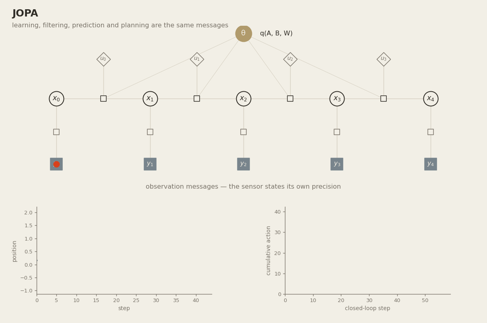
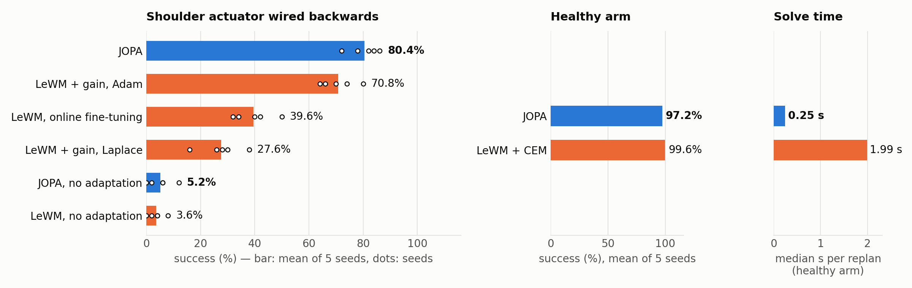
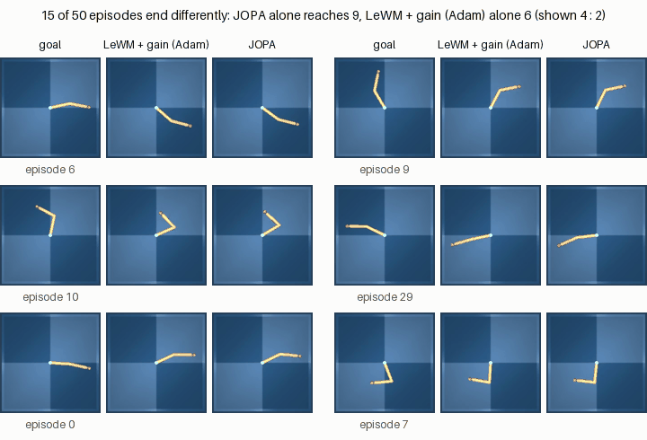
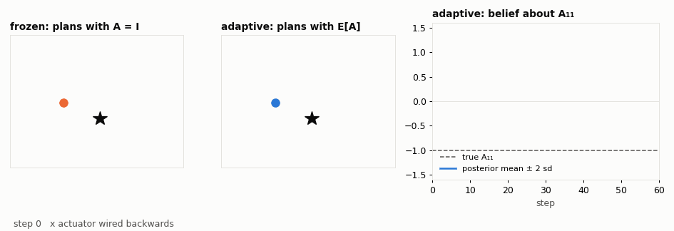

# 🍑 JOPA

**Joint Observation–Planning Architecture** — one factor graph that learns latent
dynamics, infers latent state, predicts the future, and plans actions. Every
*inference* task is message passing on that graph; the pixel encoder is the one
component trained by gradients.

[](https://github.com/lazydynamics/JOPA/actions/workflows/ci.yml)

<p align="center">
  
</p>

<p align="center"><em>
  Everything above is computed by the library — conjugate system identification,
  forward/backward message passing, and exact action inference on the same graph.
</em></p>

<p align="center">
  <a href="https://arxiv.org/abs/2603.20927">Active Inference (de Vries, 2026)</a> &nbsp;·&nbsp;
  <a href="https://doi.org/10.3390/e23070807">VMP in Factor Graphs (Şenöz et al., 2021)</a> &nbsp;·&nbsp;
  <a href="https://rxinfer.com">RxInfer</a> &nbsp;·&nbsp;
  <a href="https://lazydynamics.com">Lazy Dynamics</a>
</p>

---

## Design and background

Why message passing, the generative model, the relation to JEPA, and the credit
for the transition-node rules live in the [design notes](docs/index.md).

## The agent loop

```python
from jopa import Agent, Block, JointModel, LearnedLinear

model = JointModel([
    Block("z", LearnedLinear(dim=6, du=2, offset=True), observe=encoder),
])
model.learn(replay)                           # conjugate system identification

agent = Agent(model, horizon=6, forget=0.5)   # filter -> plan -> act -> learn
agent.goal(goal_image)                        # goals are observations too
while True:
    u = agent.step(camera())                  # one message-passing cycle
    act(u)
```

`encoder` is anything mapping an observation to a Gaussian message, so the same
loop drives your environment: wrap a feature extractor in `Frozen`, or use
`VAEObservation` for a learned pixel sensor.

## How it fits together

An `Observation` turns data into a Gaussian message, a `Block` pairs it with a
transition, and `JointModel` answers one of four questions: `learn`, `smooth`,
`filter`, `plan`.

**Offline.** Train a sensor by gradient descent — the only gradients in the
system — and encode the data once. Then fit `q(A,B,W)` by message passing:
each encoded observation becomes a message, forward–backward smooths the
chain, and the accumulated messages update the parameter posteriors.

**Online.** Every step is inference on the same graph: the **state** is
filtered, the **parameters** are updated by conjugate VMP, and the **actions**
are the posterior mode of the reaching graph. Apply the first action, discard
the rest, repeat.

All of it runs on one engine, `jopa.fg`: a factor graph solved by Gaussian
sum-product (variable elimination), relinearized where a node is nonlinear.
The `ContinuousTransition` node supplies its factor and its parameter messages
to it.

## Against LeWM, with a broken actuator

[LeWM](https://github.com/lucas-maes/le-wm) plans from pixels with a JEPA
world model and CEM. On its own Reacher checkpoint and evaluation harness,
we keep its frozen image encoder, replace its predictor and planner, and
wire the shoulder actuator backwards from the first step.

<p align="center">
  <picture>
    <source media="(prefers-color-scheme: dark)" srcset="assets/lewm_reacher_dark.png">
    
  </picture>
</p>

JOPA learns the fault with the `ContinuousTransition` node. The plant
executes `A·u`, `A ~ N(I, I)`; linearized at `E[A]`, every observed
transition is linear in `A`, and the node's `:a` and `:W` rules turn each
replan's transitions into `q(A)` and the noise `q(w)` (`jopa.Actuator`).
The first update, from 50 transitions, reads
`A = [[−1.04, −0.02], [−0.02, 1.04]]` with posterior sd ≤ 0.009 (eval seed 42).
LeWM, given the same gain on its action input, fits a biased one: Adam ends
at `(−0.56 … −0.69, 0.78 … 0.84)` across the five seeds.

<p align="center">
  
</p>

The dynamics are a neural-linear node, `x' = x + Wᵀφ(x₋₁, x, u)` (φ trained
once offline, matrix-normal `W`), and the plan is the posterior mode of the
reaching graph (`jopa.Planner`). Protocol, every run and the variants that
failed: [`benchmarks/swm_reacher`](benchmarks/swm_reacher).

## Building blocks

| | |
|---|---|
| `Gaussian`, `Wishart` | Natural-parameter distributions — every message lives here |
| `Block(name, transition, observe)` | One latent-state slice |
| `JointModel.{learn, smooth, filter, plan}` | The four queries as methods; `plan()` returns the exact Gaussian action posterior in one sweep |
| `Agent(model, horizon, forget, ...)` | The closed loop, with surprise- and excitation-gated relearning |
| `LearnedLinear` | `x' ~ N(A·x + B·u [+ c], W⁻¹)` with conjugate `q(A,B,W)`; `offset=True` learns a constant drift |
| `LearnedLinear.remember(forget)` | Posterior becomes the next prior — continual learning with exponential forgetting |
| `KnownPhysics` | Re-linearized gray-box dynamics |
| `Frozen(encode, decode)` | Any fixed encoder, plus an optional renderer |
| `VAEObservation` | Frozen probabilistic VAE sensor — heteroscedastic messages from pixels |
| `LinearCoupling` | Cross-block Gaussian factor — multimodal fusion |
| `Actuator` | The actuator matrix `A` (`u → A·u`), learned online by the CT `:a`/`:W` rules |
| `Planner` | The reaching graph: action priors, actuator limits, a goal on every future state |
| `NeuralLinear` | Neural-linear dynamics with a matrix-normal last layer |
| `fg` | The engine: `Variable`, `Fn`, `Normal`, `Box`, `Graph.infer` — every query above is one of its graphs |

Library layout: `fg/` (the engine) · `nodes/` (the CT rules, `Actuator`,
`NeuralLinear`) · `distributions.py` (messages) · `observations.py`
(likelihoods) · `transitions.py` (dynamics, VMP on the latent chain) ·
`graph.py` (`Block`, `JointModel`, coupling) · `planning.py` · `agent.py` (the
loop) · `learn.py` (feature training for `NeuralLinear`) · `nn/` (the VAE
sensor).

## A minimal example

System identification then planning on a controlled 2-D system, where the latent
is seen only through `encode`:

```python
import numpy as np
from jopa import Block, Gaussian, JointModel, LearnedLinear

def encode(x):
    lam = 1e4 * np.eye(2)
    return Gaussian(eta=lam @ x, lam=lam)

model = JointModel([
    Block("z", LearnedLinear(dim=2, du=1, n_iterations=40), observe=encode),
])
model.learn(trajectories)                                # [{"z": [...], "control": [...]}, ...]
actions = model.plan({"z": [start, None, None, goal]})   # exact posterior, one sweep
```

## Examples

| script | what it shows |
|---|---|
| [`digits_rotating.py`](examples/digits_rotating.py) | `q(A, W)` learned behind a frozen VAE from a rotating digit; the smoothing sweep forecasts the next frames (6× better than "last frame persists" at 10 steps) |
| [`reversed_actuator.py`](examples/reversed_actuator.py) | an actuator wired backwards, identified by the CT rules (`jopa.Actuator`) and planned through; `--gif` draws it |
| [`figures/hero.py`](figures/hero.py) | regenerates `assets/hero.gif` |

<p align="center">
  
</p>

Every image on this page is produced by a command in this repo, except
`assets/model.png`, which is a hand-drawn diagram. The LeWM figure and
episode montage come from `benchmarks/swm_reacher` (`report.py`, `montage.py`).

## Install and run

```bash
git clone https://github.com/lazydynamics/JOPA.git && cd JOPA
uv sync --extra viz                                  # library, examples, figures
uv run pytest tests -q
uv run python -m examples.digits_rotating            # ~1 min cold (trains a small VAE), ~5 s warm
uv run python -m examples.reversed_actuator          # seconds
```

Everything runs on CPU. The LeWM benchmark needs a CUDA machine with its
harness; see [`benchmarks/swm_reacher`](benchmarks/swm_reacher).

## How this was built

Most of this repository was written by Claude Code under human direction. Read
the code before you rely on it, treat the examples as demonstrations rather than
reference implementations, and expect bugs. Known limitations are filed as issues
rather than left implicit, including the ones that bound the results above.

The inference core is the exception. `jopa/nodes/transition.py` implements the
`ContinuousTransition` node, and its structured variational rules were derived
and ported by hand from our earlier [RxInfer](https://rxinfer.com) contribution,
and each one is checked against an independent reference — a dense Gaussian
solve, autodiff of the expected energy, or Monte Carlo — in
`tests/test_transition_rules.py`. Those rules, and the file that implements them,
are the part to trust. Forecasts (filtering, `predict`, the `smooth` rollout) use
`ct_predict`, the posterior predictive averaged over `q(A, B, W)`, rather than
the VMP forward message, which is shrunk toward the origin by design.

Contributions written with an LLM are welcome, and worth saying so in the pull
request. Keep the diff small enough for a human to review and make sure the
tests pass.

## License

GPL-3.0.
