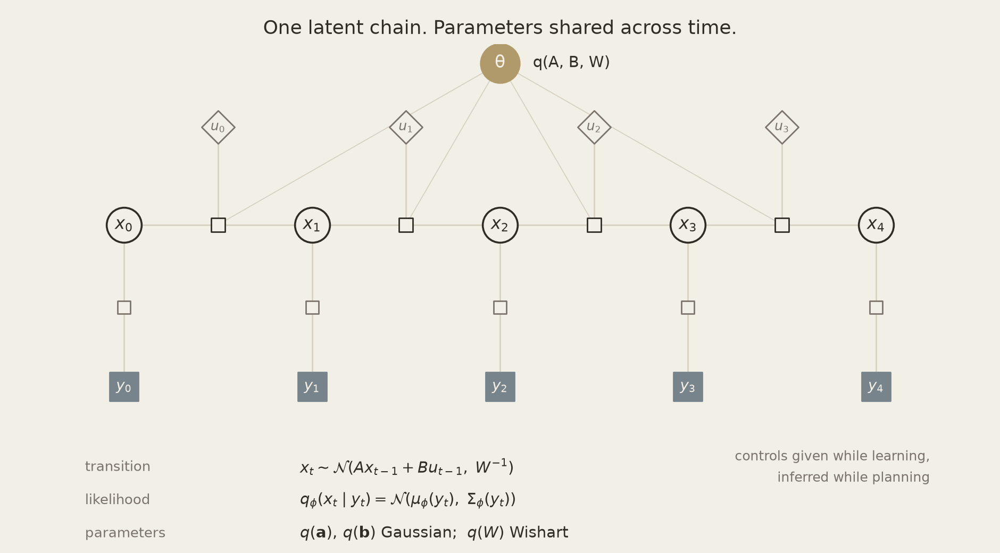

# JOPA design notes

One factor graph that learns how a system moves, infers where it is, predicts
what comes next, and decides what to do. The same message passing serves all
four; only the set of variables you admit you don't know changes.

This page is the design background. For install, examples and results see the
[README](https://github.com/lazydynamics/JOPA#readme).

## Why message passing

A learned controller is usually four systems: an encoder, a dynamics model, a
state estimator, and a policy — each with its own objective, each discarding
what the next one needs. JOPA is one probabilistic model and four questions
asked of it:

| Question | Inferred | Given |
|---|---|---|
| **System identification** | dynamics `A, B, W` | observations, controls |
| **Variational EM** | dynamics *and* encoder weights, alternating | data |
| **Filtering · smoothing · prediction** | latent state `x_t` | model, observations |
| **Planning** | action sequence `u_t` | model, start + goal |

Variational EM is available when the observation is `learnable` — the E-step
smooths, the M-step takes gradient steps on the encoder against those smoothed
targets (`LearnedVAE`). The alternative is to train the sensor first, freeze
it, and let only `q(A,B,W)` keep learning. Both routes are supported.

Only which variables are latent changes. Nothing is retrained between
questions, and three properties follow from that.

**Uncertainty is carried end to end.** The sensor emits a Gaussian whose
per-dimension precision it sets itself. The dynamics are a posterior `q(A,B,W)` —
Gaussian over `A` and `B`, Wishart over the process precision — not point
estimates. The filter weighs every observation by its precision; the planner is
certainty-equivalent, rolling the posterior-mean dynamics forward from the
filtered mean. The hero animation (`figures/hero.py`) runs the same controller
with a sensor that overstates its precision by 144× (its noise sd by 12×): the
filter trusts the noise, and the plan spends 1.9× the action for the same
accuracy.

**Planning is exact inference, not optimization.** Group each time slice as
`s_t = [x_t; u_t]` and the joint is a Gaussian chain, so the α/β recursions that
smooth the past are the optimal controller (LQG duality). One sweep, no
iteration, no mean-field cut between states and actions, no policy network.
Goals arrive as observations.

**Learning is continual by construction.** Conjugacy makes today's posterior
tomorrow's prior. `remember(forget=0.5)` tempers evidence in natural parameters,
so the model can track a drifting world instead of averaging over its history.

## Relation to JEPA — and what changes for control

JEPA methods learn an encoder by predicting in latent space; I-JEPA and V-JEPA
are self-supervised objectives with no goals, actions or control. JOPA is
goal-conditioned by construction: the goal is an observation, and planning is
inference over the same graph. The LeWM benchmark makes the relation concrete —
it keeps LeWM's frozen JEPA encoder and replaces only what sits on top of it.

Two things change when the encoder has to close a loop:

- **The predictor becomes a posterior.** A JEPA predictor is a network trained
  for the pretext task. Here it is replaced by a distribution over dynamics —
  `q(A,B,W)`, or the actuator's `q(A)` — that plans, filters and keeps learning
  online by conjugate updates.
- **The embedding can be a distribution.** JOPA's own sensors emit
  `N(μ(y), Σ(y))` with heteroscedastic precision, so fusing vision with
  dynamics knows how much to trust the encoder on this frame; a point embedding
  cannot express that.

## The model

  

A `JointModel` is a factor graph; each `Block` contributes a latent slice with a
**transition** factor and an **observation** factor. Transition parameters are
shared across all time steps:

$$
\begin{aligned}
x_t \mid x_{t-1}, u_{t-1} \;&\sim\; \mathcal{N}\!\big(A\,x_{t-1} + B\,u_{t-1},\ W^{-1}\big) && \text{(transition)} \\
y_t \mid x_t \;&\sim\; p_\theta(y_t \mid x_t) && \text{(likelihood)} \\
\mathbf{a} = \mathrm{vec}(A),\ \ \mathbf{b} = \mathrm{vec}(B) \;&\sim\; \mathcal{N}(\cdot), \quad W \;\sim\; \mathcal{W}(\cdot) && \text{(shared priors)}
\end{aligned}
$$

State and parameter inference is variational message passing under the
structured posterior $q(x)\,q(\mathbf{a})\,q(\mathbf{b})\,q(W)$: mean-field
*between* the four groups, but $q(x)$ keeps the full chain structure, so the
latent trajectory is never factorized over time. Encoder weights $\phi$ are not
in this factorization — they are fitted by gradient descent, and the resulting
$\mathcal{N}\big(\mu_\phi(y_t), \Sigma_\phi(y_t)\big)$ enters as an amortized
stand-in for $p_\theta(y_t \mid x_t)$. Planning is the exception to the
mean-field split: states and actions are solved jointly and exactly.

When the future carries no observation, the forward–backward sweep that smooths
the past predicts it — inference and prediction are one operation on different
parts of the chain.

### Where the transition rules come from

Most of the work happens in one node: `ContinuousTransition` in
[`jopa/nodes/transition.py`](https://github.com/lazydynamics/JOPA/blob/main/jopa/nodes/transition.py), the structured VMP rules
for $y \sim \mathcal{N}(Ax + Bu, W^{-1})$ when $x$ and $y$ are *both* uncertain.
That caveat is the entire difficulty. Cut the posterior as $q(y)\,q(x)$ and the
transition matrix you learn is attenuated toward zero — errors-in-variables — so
the rules have to carry $\mathbb{E}[A M A^\top]$ and the parameter-uncertainty
contractions you see in the code. Keeping $q(y,x)$ joint is what makes it
possible to learn dynamics from latents that were themselves inferred.

Everything else here is that node asked a different question, and every
question is one graph for the same engine, `jopa.fg` (Gaussian sum-product by
variable elimination). Smoothing eliminates the chain whose factors are the
node's averaged factor (`ct_marginal_yx` with no incoming messages), which
reproduces its forward and backward messages exactly; learning $q(A,B,W)$ is
its parameter messages (`ct_moments`, `ct_parameter_messages`) on the pairwise
marginals of that sweep; filtering and prediction use its posterior predictive
(`ct_predict`), which averages the transition over $q(A,B,W)$ rather than
averaging its logarithm, so parameter uncertainty widens a forecast instead of
shrinking it toward the origin; planning is a graph over the actions with the
transition at its posterior mean.

The rules themselves are not new. They were derived and integrated into
[RxInfer](https://rxinfer.com) some time ago; the write-up remains unpublished.

## Design notes

- **Bayesian inference is the only verb.** Learning, state inference, prediction
  and planning are each `q(·)` over a different subset of the same graph — no
  reward shaping, policy networks, or replay-buffer retraining.
- **Linear-Gaussian latent dynamics** with a conjugate posterior; learned
  features where a linear model cannot predict (`NeuralLinear`). The encoder and
  the features are the only gradient-trained components.
- **Planning is exact inference.** With linear dynamics the joint over states
  and actions is Gaussian, so the action posterior is one elimination sweep;
  nonlinear dynamics and actuator limits are relinearized and projected
  (`jopa.fg`).
- **Composability.** Adding a modality is appending a `Block`; information flows
  across slices through `LinearCoupling`. `JointModel` knows only blocks and
  messages — not images, proprioception, or actions.
- **Continual learning is conjugacy.** Forgetting and parameter drift are
  *priors* — exponential forgetting, random-walk diffusion on volatile
  parameters — not optimizer tricks.

## References

- de Vries, B. *Active Inference for Physical AI Agents — An Engineering Perspective*, arXiv:2603.20927, 2026.
- Şenöz, I. et al. *Variational Message Passing and Local Constraint Manipulation in Factor Graphs*, Entropy 23(7), 2021.
- Assran, M. et al. *Self-Supervised Learning from Images with a Joint-Embedding Predictive Architecture*, CVPR 2023.
- Watter, M. et al. *Embed to Control*, NeurIPS 2015; Zhang, M. et al. *SOLAR*, ICML 2019.

## Credit

The structured variational rules for learning a transition function when both
endpoints are uncertain are our own earlier work: derived and contributed to
[RxInfer](https://rxinfer.com) before this repository existed. JOPA's
`ContinuousTransition` node implements the same updates. The write-up is in
preparation.
